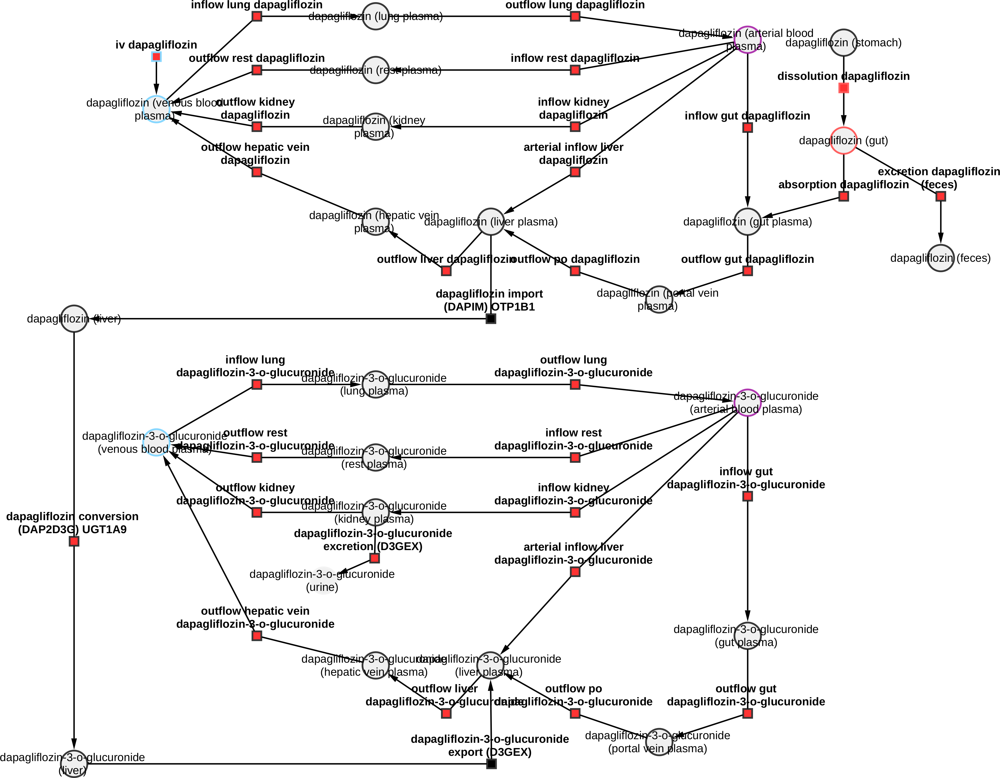
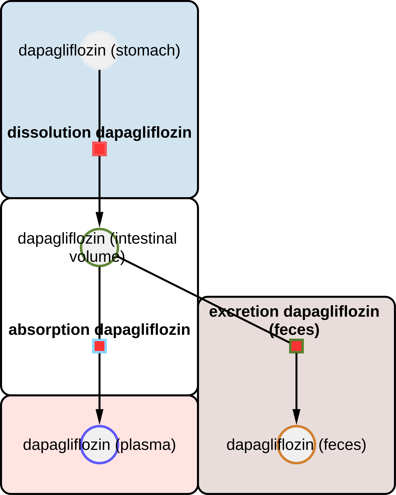
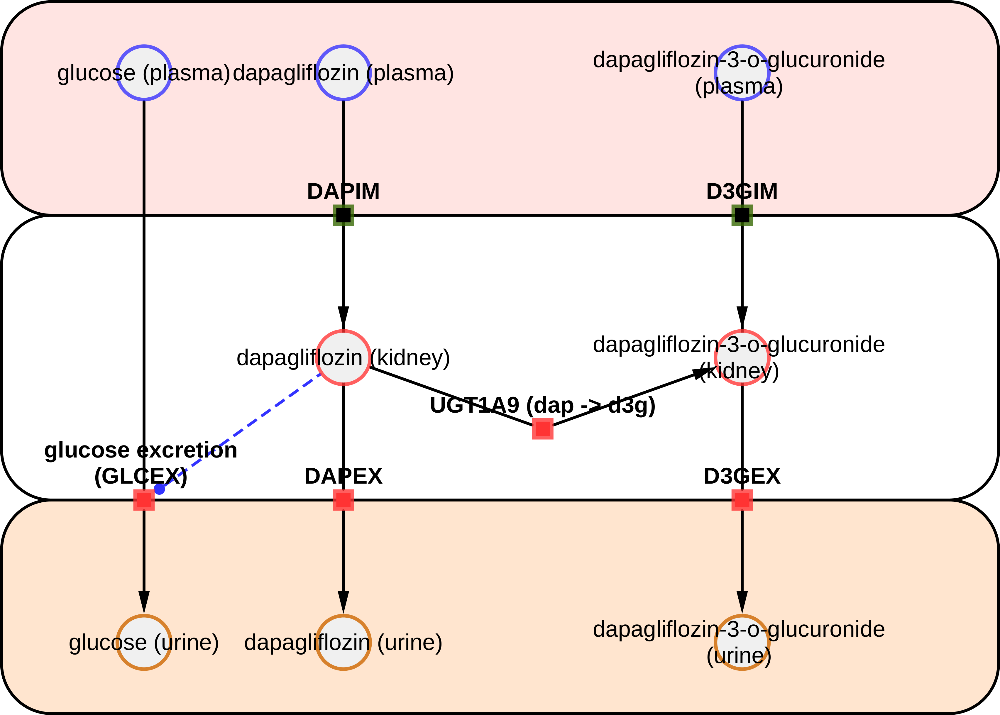
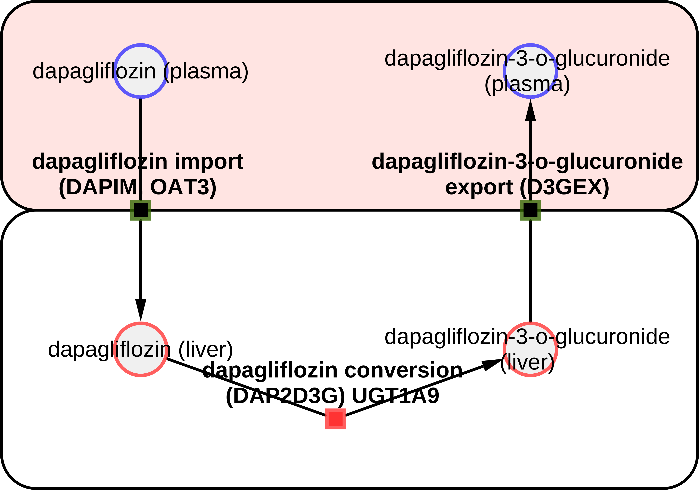

# Models

The models are distributed in [SBML](http://sbml.org) format.

## dapagliflozin_body

* Model: [`dapagliflozin_body.xml`](https://raw.githubusercontent.com/matthiaskoenig/dapagliflozin-model/main/models/dapagliflozin_body.xml)
* Equations: [`dapagliflozin_body.md`](https://github.com/matthiaskoenig/dapagliflozin-model/blob/main/models/dapagliflozin_body.md)
* Report: [SBML4humans](https://sbml4humans.de/report?url=https%3A%2F%2Fraw.githubusercontent.com%2Fmatthiaskoenig%2Fdapagliflozin-model%2Fmain%2Fmodels%2Fdapagliflozin_body.xml)

{ style="max-height: 420px; width: auto; max-width: 100%" }

## dapagliflozin_body_flat

* Model: [`dapagliflozin_body_flat.xml`](https://raw.githubusercontent.com/matthiaskoenig/dapagliflozin-model/main/models/dapagliflozin_body_flat.xml)
* Equations: [`dapagliflozin_body_flat.md`](https://github.com/matthiaskoenig/dapagliflozin-model/blob/main/models/dapagliflozin_body_flat.md)
* Report: [SBML4humans](https://sbml4humans.de/report?url=https%3A%2F%2Fraw.githubusercontent.com%2Fmatthiaskoenig%2Fdapagliflozin-model%2Fmain%2Fmodels%2Fdapagliflozin_body_flat.xml)

## dapagliflozin_intestine

* Model: [`dapagliflozin_intestine.xml`](https://raw.githubusercontent.com/matthiaskoenig/dapagliflozin-model/main/models/dapagliflozin_intestine.xml)
* Equations: [`dapagliflozin_intestine.md`](https://github.com/matthiaskoenig/dapagliflozin-model/blob/main/models/dapagliflozin_intestine.md)
* Report: [SBML4humans](https://sbml4humans.de/report?url=https%3A%2F%2Fraw.githubusercontent.com%2Fmatthiaskoenig%2Fdapagliflozin-model%2Fmain%2Fmodels%2Fdapagliflozin_intestine.xml)

{ style="max-height: 420px; width: auto; max-width: 100%" }

## dapagliflozin_kidney

* Model: [`dapagliflozin_kidney.xml`](https://raw.githubusercontent.com/matthiaskoenig/dapagliflozin-model/main/models/dapagliflozin_kidney.xml)
* Equations: [`dapagliflozin_kidney.md`](https://github.com/matthiaskoenig/dapagliflozin-model/blob/main/models/dapagliflozin_kidney.md)
* Report: [SBML4humans](https://sbml4humans.de/report?url=https%3A%2F%2Fraw.githubusercontent.com%2Fmatthiaskoenig%2Fdapagliflozin-model%2Fmain%2Fmodels%2Fdapagliflozin_kidney.xml)

{ style="max-height: 420px; width: auto; max-width: 100%" }

## dapagliflozin_liver

* Model: [`dapagliflozin_liver.xml`](https://raw.githubusercontent.com/matthiaskoenig/dapagliflozin-model/main/models/dapagliflozin_liver.xml)
* Equations: [`dapagliflozin_liver.md`](https://github.com/matthiaskoenig/dapagliflozin-model/blob/main/models/dapagliflozin_liver.md)
* Report: [SBML4humans](https://sbml4humans.de/report?url=https%3A%2F%2Fraw.githubusercontent.com%2Fmatthiaskoenig%2Fdapagliflozin-model%2Fmain%2Fmodels%2Fdapagliflozin_liver.xml)

{ style="max-height: 420px; width: auto; max-width: 100%" }

## COMBINE archive

The models and the metadata are available as COMBINE archive from [`dapagliflozin_model.omex`](https://raw.githubusercontent.com/matthiaskoenig/dapagliflozin-model/main/dapagliflozin_model.omex).
