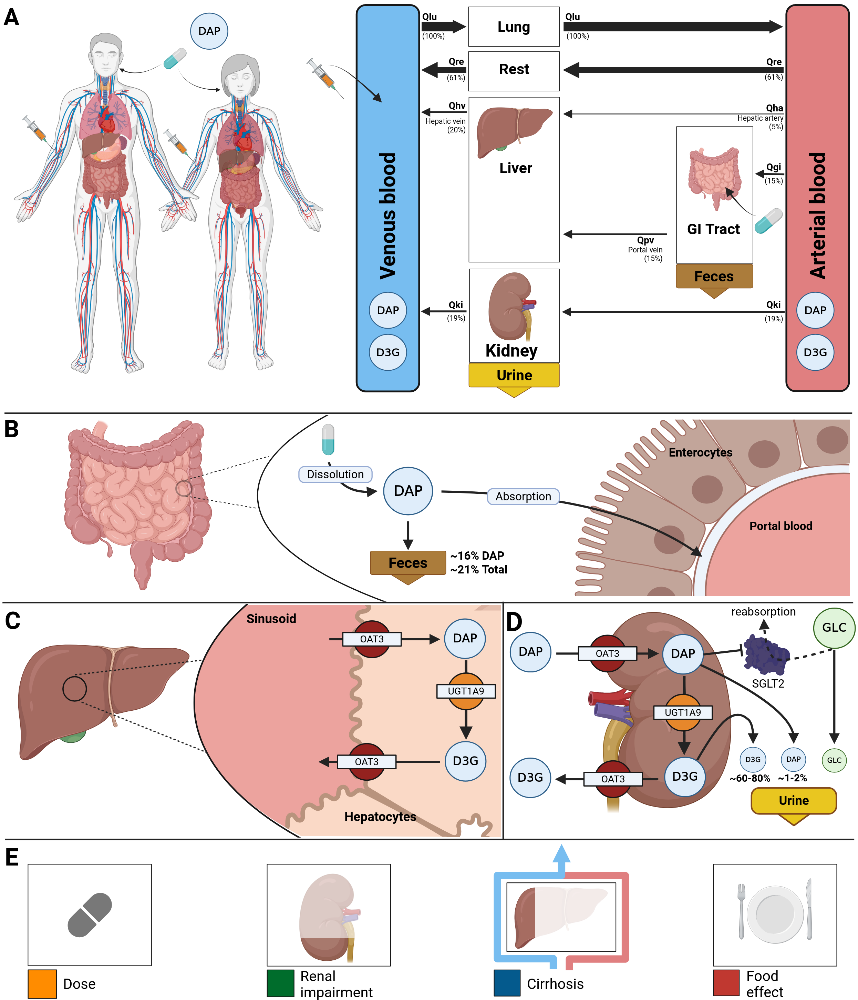

[](https://doi.org/10.5281/zenodo.13987865)
[](https://github.com/matthiaskoenig/dapagliflozin-model/actions/workflows/python.yml)
[](https://github.com/matthiaskoenig/dapagliflozin-model/actions/workflows/docker.yml)

# dapagliflozin model
This repository provides the dapagliflozin physiologically based pharmacokinetic/pharmacodynamic
(PBPK/PD) model: the oral and intravenous administration of dapagliflozin with the effect of food
(`GU__fed`), its distribution into the tissues, its glucuronidation by UGT1A9 in the liver and the
kidney to dapagliflozin-3-O-glucuronide (D3G) and the minor metabolites with the effects of the
interactions with rifampicin and mefenamic acid (`f_ugt1a9`), the renal excretion of dapagliflozin
and its metabolites relative to the glomerular filtration rate, the effects of renal impairment
(`KI__f_renal_function`) and liver cirrhosis (`f_cirrhosis`), and the pharmacodynamics: the plasma
dapagliflozin inhibits SGLT2 and lowers the renal threshold of glucose, which increases the urinary
glucose excretion depending on the fasting plasma glucose (`KI__fpg`). The fitted parameters carry
the uncertainty of their fits (`distrib:uncertainty`).
The model is developed in the model folder `pkdb_models/models/dapagliflozin` of the repository
[pkdb_models](https://github.com/matthiaskoenig/pkdb_models).

The model is distributed as [SBML](http://sbml.org) format available from [`dapagliflozin_body_flat.xml`](./models/dapagliflozin_body_flat.xml) with 
corresponding [SBML4humans model report](https://sbml4humans.de/report?url=https%3A%2F%2Fraw.githubusercontent.com%2Fmatthiaskoenig%2Fdapagliflozin-model%2Fmain%2Fmodels%2Fdapagliflozin_body_flat.xml) and [model equations](./models/dapagliflozin_body_flat.md).

The COMBINE archive is available from [`dapagliflozin_model.omex`](./dapagliflozin_model.omex). 
The FAIR assessment is available from [`dapagliflozin_model_fair.xlsx`](./dapagliflozin_model_fair.xlsx).



### Comp submodels
* **liver** submodel [`dapagliflozin_liver.xml`](./models/dapagliflozin_liver.xml) with [SBML4humans report](https://sbml4humans.de/report?url=https%3A%2F%2Fraw.githubusercontent.com%2Fmatthiaskoenig%2Fdapagliflozin-model%2Fmain%2Fmodels%2Fdapagliflozin_liver.xml) and [equations](./models/dapagliflozin_liver.md).
* **kidney** submodel [`dapagliflozin_kidney.xml`](./models/dapagliflozin_kidney.xml) with [SBML4humans report](https://sbml4humans.de/report?url=https%3A%2F%2Fraw.githubusercontent.com%2Fmatthiaskoenig%2Fdapagliflozin-model%2Fmain%2Fmodels%2Fdapagliflozin_kidney.xml) and [equations](./models/dapagliflozin_kidney.md).
* **intestine** submodel [`dapagliflozin_intestine.xml`](./models/dapagliflozin_intestine.xml) with [SBML4humans report](https://sbml4humans.de/report?url=https%3A%2F%2Fraw.githubusercontent.com%2Fmatthiaskoenig%2Fdapagliflozin-model%2Fmain%2Fmodels%2Fdapagliflozin_intestine.xml) and [equations](./models/dapagliflozin_intestine.md).
* **whole-body** submodel [`dapagliflozin_body.xml`](./models/dapagliflozin_body.xml) with [SBML4humans report](https://sbml4humans.de/report?url=https%3A%2F%2Fraw.githubusercontent.com%2Fmatthiaskoenig%2Fdapagliflozin-model%2Fmain%2Fmodels%2Fdapagliflozin_body.xml) and [equations](./models/dapagliflozin_body.md).

## How to cite
To cite the model repository

> Nemitz, N., Elias, M. & König, M. (2025).
> *Physiologically based pharmacokinetic/ pharmacodynamic (PBPK/PD) model of dapagliflozin.*   
> Zenodo. [https://doi.org/10.5281/zenodo.13987865](https://doi.org/10.5281/zenodo.13987865)

To cite the main publication

> Nike Nemitz, Michelle Elias, Matthias König
> A Physiologically Based Pharmacokinetic and Pharmacodynamic (PBPK/PD) Model of Dapagliflozin in Type 2 Diabetes Mellitus: The Effect of Dosing, Hepatorenal Impairment, and Food
> Pharmaceutics 2026, 18(3), 287; [doi:10.3390/pharmaceutics18030287](https://doi.org/10.3390/pharmaceutics18030287) 

To cite the reproducibility publication

> Michelle Elias, Mariia Myshkina, Nike Nemitz, Matthias König
> Reproducibility of a Physiologically Based Pharmacokinetic and Pharmacodynamic (PBPK/PD) Model of Dapagliflozin
> Physiome. February 19, 2026; [doi:10.36903/physiome.31368556](https://doi.org/10.36903/physiome.31368556)

## License

* Source Code: [MIT](https://opensource.org/license/MIT)
* Documentation: [CC BY-SA 4.0](http://creativecommons.org/licenses/by-sa/4.0/)
* Models: [CC BY-SA 4.0](http://creativecommons.org/licenses/by-sa/4.0/)

This program is distributed in the hope that it will be useful, but WITHOUT ANY
WARRANTY; without even the implied warranty of MERCHANTABILITY or FITNESS FOR A
PARTICULAR PURPOSE.

## Run simulations
### python
Clone the repository 
```bash
git clone https://github.com/matthiaskoenig/dapagliflozin-model.git
cd dapagliflozin-model
```

#### uv
Setup environment with uv (https://docs.astral.sh/uv/getting-started/installation/)
```bash
uv sync
```
Run the complete analysis:
```bash
uv run run_simulation pkdb_models.models.dapagliflozin -a all -r results
```

#### pip
If you use pip install the package via
```bash
pip install -e .
```
Run the complete analysis in the environment via:
```bash
run_simulation pkdb_models.models.dapagliflozin -a all -r results
```

### docker
Simulations can also be run within a docker container:

```bash
docker run -v "${PWD}/results:/results" -it matthiaskoenig/dapagliflozin:latest /bin/bash
```

Run the complete analysis:
```bash
uv run run_simulation pkdb_models.models.dapagliflozin -a all -r /results
```
The results are written into the mounted `/results` folder on the host.

In case of permission issues with the mounted folder, adjust ownership and access rights with:
```bash
sudo chown $(id -u):$(id -g) -R "${PWD}/results"
sudo chmod 775 "${PWD}/results"
```

## Funding

Matthias König was supported by the Federal Ministry of Research, Technology and Space (BMFTR, Germany) within ATLAS by grant number 031L0304B and by the German Research Foundation (DFG) within the Research Unit Program FOR 5151 QuaLiPerF (Quantifying Liver Perfusion-Function Relationship in Complex Resection - A Systems Medicine Approach) by grant number 436883643 and by grant number 465194077 (Priority Programme SPP 2311, Subproject SimLivA). This work was supported by the BMBF-funded de.NBI Cloud within the German Network for Bioinformatics Infrastructure (de.NBI) (031A537B, 031A533A, 031A538A, 031A533B, 031A535A, 031A537C, 031A534A, 031A532B). 

© 2024-2026 Matthias König, [Systems Medicine of the Liver](https://livermetabolism.com)
